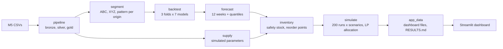

# Retail Demand and Supply Planner

A demand and supply planning system on real Walmart sales data (M5): demand segmentation, statistical, intermittent and machine learning forecasting with rolling backtests, probabilistic safety stock, LP-based allocation of constrained supply across distribution centres, Monte Carlo scenario simulation and a planner dashboard. Supply parameters are simulated.

## What it is

- **Real demand:** weekly sales of 150 FOODS_3 items in the three M5 states (CA, TX, WI), each state treated as one distribution centre (DC). 277 complete weeks, 450 item-DC series.
- **Simulated supply:** M5 has sales only, so lead times (1 to 4 weeks), supplier capacity, DC capacity, unit costs and opening stock are simulated from each series' own demand with a fixed seed.
- **The planning loop:** segment every series (ABC, XYZ, Syntetos-Boylan pattern), backtest seven forecasting models over three 12-week folds, choose a model per demand pattern, forecast the next 12 weeks, set safety stock from the measured forecast error, allocate limited supplier capacity across DCs with a linear program, and stress-test the result with 200 Monte Carlo runs under five scenarios.



## Data download

The data is not in this repository. To get it:

1. Create a Kaggle account and accept the rules on the "M5 Forecasting - Accuracy" competition page. Without this the download fails with a 403 error.
2. Create an API key on your Kaggle account page and place `kaggle.json` in your home `.kaggle` folder (`C:\Users\<you>\.kaggle\kaggle.json` on Windows, `~/.kaggle/kaggle.json` on Linux or macOS, then `chmod 600 ~/.kaggle/kaggle.json`). Never put it inside this repository.
3. Download and unzip into `data/raw/`:

```
kaggle competitions download -c m5-forecasting-accuracy -p data/raw
cd data/raw
unzip m5-forecasting-accuracy.zip
```

The pipeline uses `sales_train_evaluation.csv`, `calendar.csv` and `sell_prices.csv`.

## How to run

Python 3.12.

```
python -m venv .venv
.venv/Scripts/activate            # Windows; on Linux or macOS: source .venv/bin/activate
pip install -r requirements.txt
python run_all.py --stage all     # about 3 minutes on a laptop (188 s measured)
streamlit run app/streamlit_app.py
pytest -q
```

Stages can be run one at a time, in order: `pipeline`, `supply`, `segment`, `backtest`, `forecast`, `inventory`, `simulate`, `app_data`. Each reads its inputs from `data/` and writes its outputs there. Every setting lives in `config.yaml`.

`app_data/` holds the small derived files the dashboard reads (segments, scores, forecasts, a 52-week history per series, policy and simulation results). It is derived from M5 data, so check the competition's data rules before publishing it; if in doubt, deploy without it and use screenshots instead. It is not committed to this repository.

## Design decisions

Every phase has an entry in [docs/DECISIONS.md](docs/DECISIONS.md) explaining what was built, the key choices and why, with the numbers from the run. The specification is [docs/BUILD_PLAN.md](docs/BUILD_PLAN.md); the amendments agreed during the build are listed at its top. Highlights:

- **No leakage by construction:** segments are recomputed at each backtest origin; LightGBM uses direct, horizon-grouped models whose lags are all at least the group's largest horizon; future rows enter the feature panel with units removed. Tests prove both.
- **Honest item selection:** the 150 items are ranked on the 52 weeks before the first test window, not on the weeks being tested.
- **WAPE, volume-weighted, with FVA against naive**, and model selection per demand pattern rather than per item (per-item selection overfits three folds).
- **Safety stock from forecast error**, classic and quantile-based, with service levels by ABC class; the simulation measures fill rate and cycle service separately because they are different things.

## Results summary

Full tables, each with the command that produced it: [RESULTS.md](RESULTS.md). Headlines from the last run:

- LightGBM is the most accurate model overall (WAPE 0.280, 8.9 points better than naive) and is chosen for smooth, erratic and lumpy series. For intermittent series the selection rule picks naive by 0.2 points of WAPE, and those series reach only 65% fill rate in the simulation.
- Baseline policy: 92.4% fill rate. Supplier capacity binds in 59% of item-weeks; with unlimited supply the same policy reaches 99.4%.
- Fair-share allocation beats the LP on fill rate over 12 weeks (93.8% vs 92.4%), although the LP wins on its own weighted objective in a single constrained week. DECISIONS.md, Phase 8, explains why.
- Recomputing reorder points after a 2-week lead time shock recovers 7.1 points of fill rate (79.4% to 86.5%).

## Limitations

- Supply parameters are simulated, not observed.
- Single echelon: one supplier per item shipping to three DCs; no stores, no multi-level network.
- Lost sales assumption: unmet demand is lost, never backordered.
- Prices are held flat over the forecast horizon; calendar events and SNAP days beyond `calendar.csv` are filled by date and flagged.
- US retail data rather than Indian FMCG; the three DCs are states, not real warehouses.
- The order-up-to level is set once at the forecast origin and not re-planned during the 12 simulated weeks.
